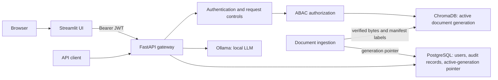

# Paladin

Paladin is a self-hosted, clearance-aware question-answering gateway for internal documents. It combines authenticated access, attribute-based document authorization, prompt screening, retrieval from a versioned vector index, local language-model generation, and an audit trail. It demonstrates security controls around a retrieval-augmented generation (RAG) application; it is a portfolio project, not a claim of production readiness for every organization or threat.

## Architecture



The UI, API, PostgreSQL, ChromaDB, and Ollama run as Docker Compose services. The API applies authorization before returning retrieved document content to the model. PostgreSQL stores user and audit records and identifies the active vector generation.

## Security model

### Authentication

The API issues and validates RS256-signed JWTs. It checks required claims, issuer, and audience, then compares token user attributes against the current user record.

### Document authorization

The V1 read policy requires both:

1. The user's global clearance level is at least the document's classification level.
2. The document is company-wide, or its department matches the user's department.

An administrator role does not bypass these checks. Chroma applies the matching filter, and the API checks each returned chunk again. Invalid attributes fail closed.

Clearance levels are global:

- **Level 1:** general internal information
- **Level 2:** business-sensitive information
- **Level 3:** critical or executive information

The four seeded local-development users and the expected 16-case access matrix are:

| User | Department | Clearance | Engineering policy (L1, department) | Finance guidelines (L2, department) | Executive briefing (L3, department) | HR handbook (L2, company-wide) |
|---|---|---:|---|---|---|---|
| `emp1` | Engineering | 1 | Allow | Deny | Deny | Deny |
| `mgr1` | Engineering | 2 | Allow | Deny | Deny | Allow |
| `admin1` | Executive | 3 | Deny | Deny | Allow | Allow |
| `fin1` | Finance | 2 | Deny | Allow | Deny | Allow |

### Prompt and data controls

- **PII redaction:** Pattern-based checks detect selected card, Aadhaar, email, phone, and SSN formats in the user prompt. Redaction happens before downstream prompt handling and relevant audit writes. Retrieved document content is not scrubbed.
- **Injection defense:** A limited pattern set blocks direct injection attempts. Retrieved text is separated and labeled as context, and the model is instructed not to follow instructions embedded in that context.
- **Rate limiting:** The defaults are 10 requests per minute and a 20-request `/ask` burst per minute, plus a sustained cap of 60 `/ask` requests per six minutes. Limits are per authenticated user, or per IP for anonymous callers. The in-memory limiter is local to each API process.
- **Audit records:** PostgreSQL records requests, denials, PII events, and authentication failures in `request_logs`, `denial_logs`, `pii_events`, and `auth_failure_logs`.
- **Document integrity:** Ingestion checks each document's SHA-256 digest against the manifest, validates classification metadata, builds a new generation, and then switches the active-generation pointer in PostgreSQL.

## Local quick start

This is the five-minute setup path once Docker is installed and images and models are available. First-run downloads can take longer. From a shell with Docker Compose, Bash, and OpenSSL:

```bash
cd paladin
cp .env.example .env
```

Set a local `POSTGRES_PASSWORD` in `.env`, then generate a local signing key pair and start the services:

```bash
bash scripts/generate_rsa_keys.sh
docker compose up -d --build
```

Pull the configured Ollama model, build the document index, and seed a **throwaway local database** with local-development demo users:

```bash
bash scripts/setup_ollama.sh
docker compose exec -T -e PYTHONPATH=/app paladin-api python data/ingest.py
docker compose run --rm --no-deps paladin-seeder --local-dev
```

Open the Streamlit UI at <http://localhost:8501>. Sign in using one of the usernames in the table above and that account's local-development password. The values are intentionally not repeated in this publication README. Never use local-development accounts on a hosted or public system.

The API health endpoint is <http://localhost:8000/health> and the API documentation is <http://localhost:8000/docs>.

### First-run model downloads

The default Ollama model is `llama3.2:3b` (listed as **2.0 GB**). The first document ingestion also downloads the embedding model. In a fresh-clone measurement, its cache occupied **795,055,641 bytes** (about **795 MB / 758 MiB**) after ingesting the four sample documents. Downloads need network access and can extend setup time.

## What has been verified

- The latest accepted isolated-suite report recorded **129 pytest cases passed** and **5 unittest cases passed**, with zero skips or failures.
- A separate fresh-clone ingestion check succeeded and ingested four chunks.
- The generation-aware API deployment and first live generation-aware ingestion were completed and accepted for the **local Docker stack**. The reported acceptance checks included the access matrix and authenticated smoke requests.
- Generation cutover and rollback were rehearsed in scratch environments; rollback was **not** exercised on the live stack.

These results describe this repository and its local Docker stack. They do not establish suitability for every production environment.

## Known limitations

- **No TLS is configured.** Compose traffic is plain HTTP; use a TLS-terminating reverse proxy before exposing the UI or API beyond a local demonstration.
- **The rate limiter is in memory.** Limits do not coordinate across API workers or replicas.
- **Injection defense is limited.** Direct prompt checks use patterns; retrieved-content handling relies on context separation and model instructions rather than comprehensive detection.
- **PII detection is pattern-based.** It may miss formats it does not recognize and does not scrub retrieved documents.
- **Document classification is manual.** Manifest labels require owner review; content hashes bind document bytes, not classification fields or approver identity.
- **Inference is CPU-oriented.** Response time depends on the host, model, and prompt; requests may queue behind local inference.
- **No cloud deployment has been verified.**

## What this demonstrates

- A retrieval-augmented application with authentication and document-level ABAC checks.
- Defense in depth through Chroma query filters and a secondary per-chunk authorization check.
- Prompt preprocessing, bounded injection screening, and structured audit records.
- Versioned vector generations with a PostgreSQL active pointer and rehearsed rollback behavior.
- Explicit test and deployment evidence boundaries rather than treating mocked, isolated, and live checks as interchangeable.

## Design decisions

- **Local inference:** Ollama keeps generation in the local Docker stack and avoids a hosted LLM API dependency for the demo.
- **Fail-closed authorization:** malformed user or document attributes deny access; admin role does not override document policy.
- **Two authorization checks:** a vector-store filter narrows retrieval and a per-chunk check catches inconsistent metadata.
- **Generation pointer cutover:** ingestion builds and validates a new collection before switching the PostgreSQL pointer; it does not rewrite the active collection in place.
- **Solo-owner classification workflow:** document labels are manually reviewed before ingestion; multi-person approval enforcement is out of scope for this portfolio project.

## Project structure

```text
paladin/
├── data/
│   ├── documents/       Sample source documents
│   ├── manifest.json    Classification labels and content hashes
│   └── ingest.py        Versioned document ingestion
├── docs/                Classification and operations documentation
├── gateway/
│   ├── auth/            JWT authentication
│   ├── authz/           ABAC policy
│   ├── db/              Models, sessions, and user seeding
│   ├── llm/             Ollama client
│   ├── middleware/      Request and correlation middleware
│   ├── rag/             Generation pointer and vector retrieval
│   ├── routes/           HTTP API routes
│   └── security/        PII, injection, and rate-limit controls
├── scripts/              Key generation, model setup, test runner
├── tests/                Unit, isolated, and live integration suites
├── ui/                   Streamlit frontend
└── docker-compose.yml
```

## Links

- [Ollama `llama3.2:3b` model](https://ollama.com/library/llama3.2:3b)
- [Docker Compose documentation](https://docs.docker.com/compose/)
- [FastAPI documentation](https://fastapi.tiangolo.com/)
- [Streamlit documentation](https://docs.streamlit.io/)
- [Chroma documentation](https://docs.trychroma.com/)
- [Sentence Transformers documentation](https://www.sbert.net/)
